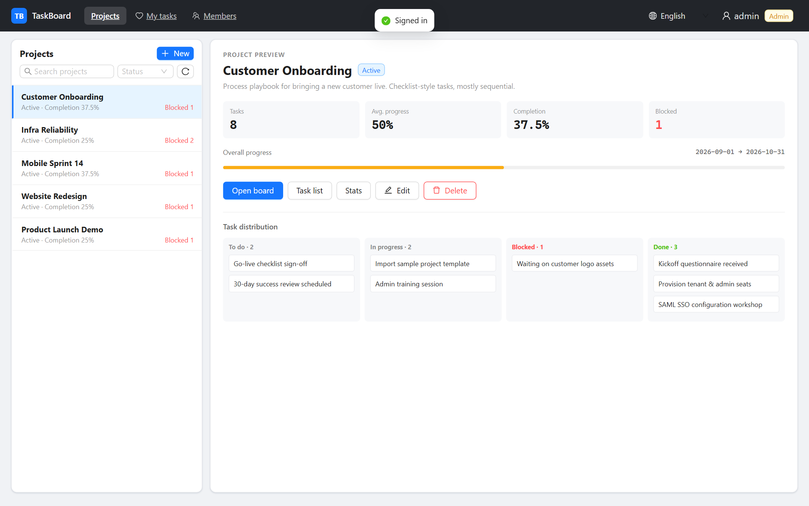
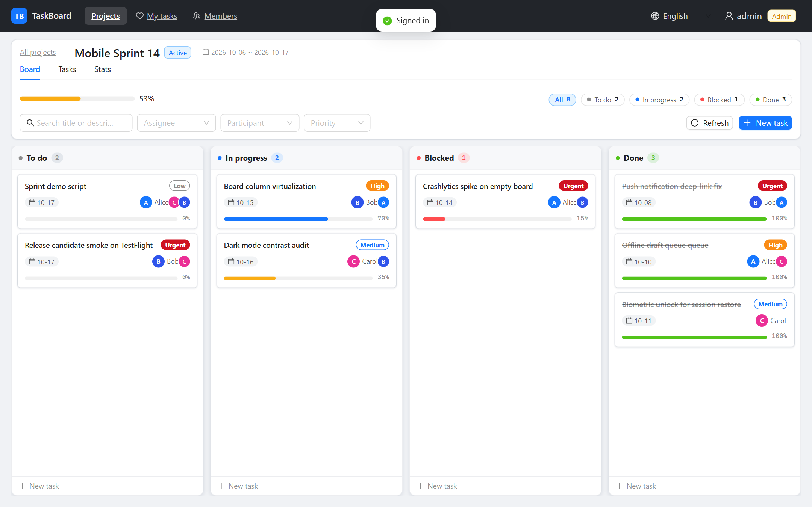

# 任务看板（TaskBoard）

**面向小团队的自托管项目与任务进度看板。**

[English](README.md)

[](LICENSE)
[](https://www.typescriptlang.org/)
[](https://vuejs.org/)
[](https://nestjs.com/)
[](https://www.postgresql.org/)
[](https://docs.docker.com/compose/)

[界面预览](#界面预览) · [快速开始](#快速开始) · [部署](#部署到服务器) · [功能](#核心能力) · [API](http://localhost:3000/api/docs) · [贡献](CONTRIBUTING.md)

看板拖拽流转任务、进度自动汇总，支持评论与操作日志、统计图表，以及多人 Socket.IO 实时同步。前后端全 TypeScript，一条 `docker compose` 即可部署。

---

## 界面预览

| 项目墙 | 看板 |
| --- | --- |
|  |  |

---

## 核心能力

- **会算进度的看板** — 四列（未开始 / 进行中 / 阻塞 / 已完成）拖拽改状态、列内排序；拖到「已完成」进度自动 100%。
- **项目一眼看清** — 主从首页：左选项目、右看摘要与迷你四列，再进入看板 / 列表 / 统计。
- **贴近真实协作的任务** — 负责人、多参与人、优先级、0–100 进度、计划与实际日期；列表支持筛选、排序、批量修改与「我的待办」。
- **协作可追溯** — 评论 + 操作日志时间线（谁把什么从 A 改成了 B）。
- **多人实时同步** — Socket.IO 推送看板变更，他人无需手动刷新。
- **统计图表** — ECharts：状态 / 优先级 / 负责人任务数与平均进度。
- **英文 & 简体中文** — 登录页与顶栏可切换，本地持久化。
- **小团队权限** — 账号密码登录，管理员 / 成员两种角色。

---

## 技术栈

| 层 | 选型 |
| --- | --- |
| 前端 | Vue 3 · Vite · TypeScript · Ant Design Vue · Pinia · ECharts · Socket.IO Client |
| 后端 | NestJS · Prisma · TypeScript · Passport JWT · Socket.IO |
| 数据库 | PostgreSQL 16 |
| 部署 | Docker Compose（`nginx` + `api` + `postgres`） |

---

## 快速开始

需要 **Node.js 20+** 与 **Docker**。

```bash
# 1. 环境变量
cp .env.example .env

# 2. 只起数据库（默认宿主机 5432，冲突则改 POSTGRES_PORT）
docker compose --env-file .env -f docker/docker-compose.dev.yml up -d

# 3. 后端
cd backend
npm install
npx prisma migrate deploy     # 建表
npx prisma db seed            # 初始管理员
npm run start:dev             # http://localhost:3000/api · Swagger /api/docs

# 4. 前端（另开终端）
cd frontend
npm install
npm run dev                   # http://localhost:5173
```

| | |
| --- | --- |
| 初始账号 | `admin` |
| 密码 | `.env` 中 `ADMIN_INITIAL_PASSWORD`（默认 `Admin@123456`）— **登录后请立即修改** |

开发期 Vite 将 `/api`、`/socket.io` 代理到 `localhost:3000`，无需单独配 CORS。

### 演示数据

本地截图 / 走查：

```bash
cd backend && npm run db:seed:demo
```

幂等创建 5 个风格不同的虚构项目（产品发布 / 官网改版 / 移动 Sprint / 基础设施 / 客户开通；成员 `alice` / `bob` / `carol`、四列任务、评论与日志）。库内为英文；切换界面语言时标题/描述自动映射。演示密码默认 `Demo@123456`（`DEMO_USER_PASSWORD`）。**生产勿执行。**

---

## 部署到服务器

一条命令起生产栈：

```bash
cp .env.example .env
# 至少改掉：
#   JWT_SECRET=$(openssl rand -hex 32)
#   POSTGRES_PASSWORD=<强密码>
#   ADMIN_INITIAL_PASSWORD=<初始管理员密码>
docker compose --env-file .env -f docker/docker-compose.yml up -d --build
# → http://<服务器IP>:8080
```

`api` 容器启动时自动迁移并创建管理员（幂等）。

接口文档：后端启动后访问 Swagger `http://localhost:3000/api/docs`（或部署域名 + `/api/docs`）。

---

## 测试

```bash
cd backend && npm run test
cd frontend && npm run typecheck

python scripts/api-smoke.py
python scripts/api-smoke.py --base http://localhost:8080/api

cd frontend && node scripts/ws-smoke.mjs http://localhost:8080
```

---

## 目录结构

```
├─ backend/            NestJS + Prisma
│  ├─ prisma/          schema、migrations、seed
│  └─ src/             auth · users · projects · tasks · comments · activities · stats · realtime
├─ frontend/           Vue 3 + Vite + Ant Design Vue
├─ docker/             生产 / 开发 Compose
└─ scripts/            api-smoke.py 等
```

---

## 注意

1. **compose 不会自动读仓库根目录 `.env`。** compose v2 以 compose 文件所在目录（`docker/`）为项目目录，须在仓库根执行并带 `--env-file .env`。
2. **Socket.IO 经 nginx 须带 `Upgrade` 头**，否则会退化成轮询，实时同步看起来失效。`frontend/nginx.conf` 已配好。

---

## 安全

- 勿把真实密钥写入仓库；只用 `.env`（已 gitignore），`.env.example` 仅占位符。
- 安全问题请尽量私下联系维护者，避免在公开 Issue 中贴可利用细节。

---

## 参与贡献

见 [CONTRIBUTING.md](CONTRIBUTING.md)。欢迎缺陷反馈与聚焦的 PR。

---

## 许可证

[MIT](LICENSE) — 可自由使用、修改与自托管。
